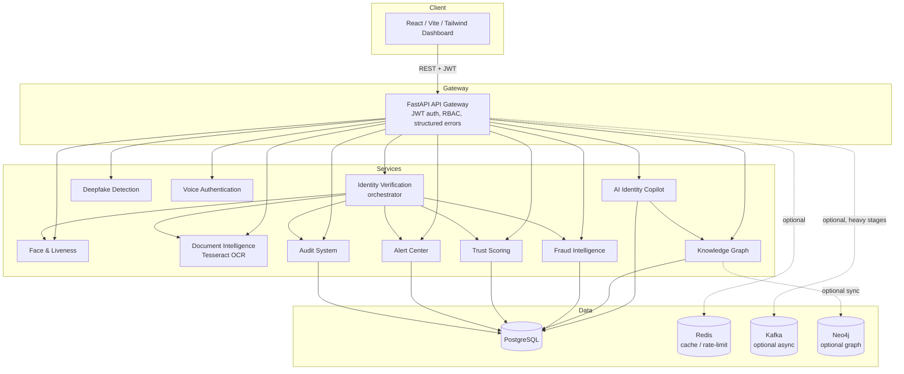
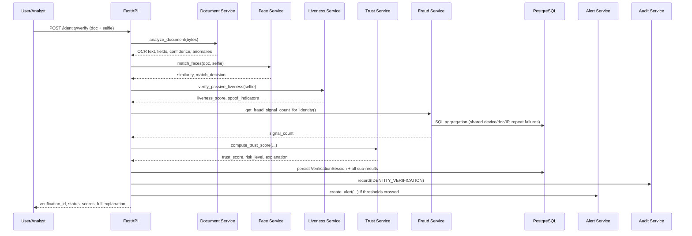

# ARCHITECTURE.md — EEF Platform

## Component Overview



## Verification Pipeline (Sequence)



## Synchronous vs. Asynchronous Flows

**Synchronous (default, demo mode):** the entire verification pipeline
(OCR → face → liveness → trust → fraud → decision → audit → alert) runs
in-process within a single HTTP request. This is intentional for the demo:
every stage is CPU-bound OpenCV/Tesseract work on small images, completing in
well under a second, and keeping it synchronous makes the API trivially
testable (see the 35-test pytest suite) without a broker dependency.

**Asynchronous (partial):** `backend/app/workers/kafka_consumer.py` can
consume `verification.started` when `KAFKA_ENABLED=true` and invoke the same
verification service. The HTTP API currently does not publish that event,
and the worker does not publish a completion event; the topic list describes
the planned event contract, not a complete event-driven implementation.

## Knowledge Graph: NetworkX vs. Neo4j

`graph_service.py` builds a live `networkx.MultiDiGraph` from the relational
database on every query. This is a genuine graph engine (real
`degree_centrality`, `connected_components` algorithms) — not a stub — and is
the only active graph query engine. The Neo4j container, credentials, seed
Cypher, and health probe are provided, but the application does not currently
write or query graph data in Neo4j; `NEO4J_ENABLED` does not switch the graph
service.

## Trust Scoring: Full Transparency

```
trust_score = 100 * (
    identity_score  * w_identity  +
    biometric_score * w_biometric +
    liveness_score  * w_liveness  +
    document_score  * w_document  +
    behavior_score  * w_behavior  +
    device_score    * w_device
) - risk_penalties
```

All weights live in `backend/app/core/config.py` (`TRUST_WEIGHTS`), never
hidden in code. `risk_penalties` are named, independently configurable point
deductions (fraud signals, deepfake flag, face mismatch, low liveness). The
full computation — inputs, base score, penalties, thresholds — is returned in
every API response's `explanation` field, satisfying Section 19
(Explainable AI) without needing a separate SHAP pass, since the formula
itself is already fully interpretable. Where a genuinely trained model
replaces the formula in the future, SHAP or integrated-gradients would be the
natural next step.

## Rate Limiting

Requests under `/api/v1` use the configured `RATE_LIMIT_PER_MINUTE` fixed
window. Redis `INCR` with an expiry is used when `REDIS_ENABLED=true`; if Redis
is disabled or unavailable, each backend process applies a bounded
in-memory fallback. The fallback is suitable for local/demo use only and is
not shared across replicas.

## Object/File Storage

Uploaded files are validated (extension allow-list + magic-byte sniff + size
cap), renamed to a UUID-based internal filename (never trusting the client
filename), and written under `UPLOAD_DIRECTORY` (a Docker volume in compose),
outside any executable code path.

<a id="scale-note"></a>
## Scale Note

This architecture is designed to scale horizontally (stateless API replicas
behind Nginx/a load balancer, Postgres read replicas, Kafka partitioning,
Neo4j clustering) — but **this implementation is a functional prototype
tested on demo-scale data** (tens of identities, ~30 verification sessions).
No claim is made about supporting production-scale record volumes without
further load testing and infrastructure investment.
